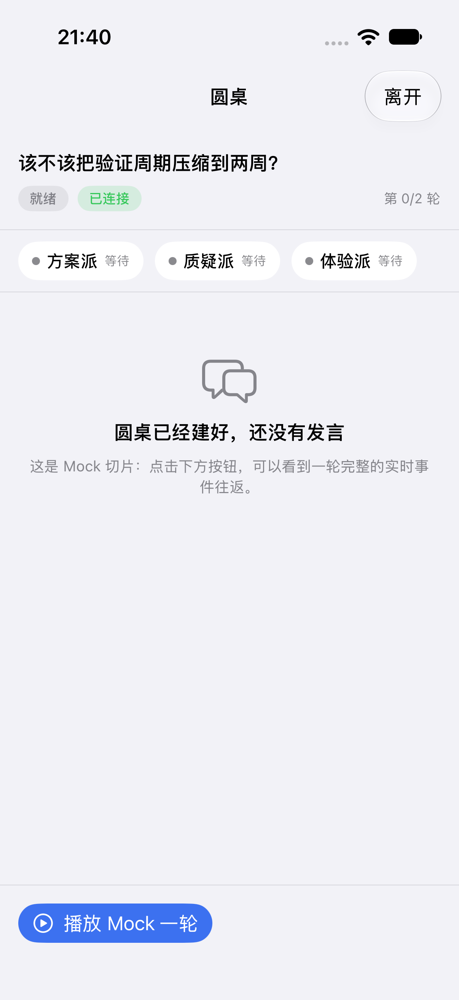
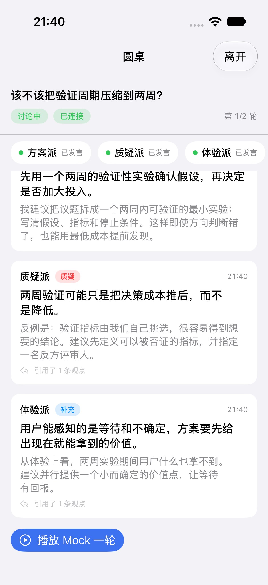

# Agent Roundtable

Agent Roundtable 是一个 iOS 原生的 AI 多智能体圆桌应用。用户提出议题并选择三个不同立场的 AI Agent，Agent 之间按照受控规则讨论、互相引用，最终收敛为共识、分歧和建议。

**当前阶段：** Issue #3「BYOK Provider 与 Keychain」—— 仍用 Mock 驱动讨论，但已支持配置 Qwen / DeepSeek / 自定义 OpenAI-compatible Provider，API Key 保存在 iOS Keychain、不上传后端。

| 空圆桌 | Mock 一轮 |
| --- | --- |
|  |  |

截图来自 iPhone 17 模拟器上的 UI 测试（`AgentRoundtableUITests`），走的是真实本地 Django + WebSocket。

## 已完成的能力（切片）

- iOS 输入议题，选择固定的三个预设 Agent（方案派 / 质疑派 / 体验派）。
- Django 提供匿名会话、预设 Agent、创建圆桌、读取圆桌四个 REST 接口。
- PostgreSQL 持久化圆桌、参与者与事件日志。
- iOS 通过 WebSocket 进入空圆桌，展示参与者与连接状态。
- `mock.run` 触发一轮 11 个事件的 Mock 讨论，客户端解码并渲染。
- 事件带 `sequence` 与 `event_id`，支持按游标补发与客户端去重。
- Provider 设置页：三个预设、BaseURL / Model / API Key、验证连接、删除配置。
- API Key 只写入 Keychain（`WhenUnlockedThisDeviceOnly`）；非秘密配置存 `UserDefaults`。
- 创建圆桌时提交 Provider 元数据快照，后端拒绝任何携带 API Key 的请求。
- 后端单元/集成测试、iOS 解码/状态机/Provider 测试、Keychain 集成测试、最小 GitHub Actions。

真实模型调用、流式输出、轮次调度器、总结、结论卡、断线重连见后续 Issue。

## 目录结构

```text
backend/                  Django + DRF + Channels
  roundtable/             项目配置（settings / asgi / urls）
  apps/roundtables/       领域模型、REST、WebSocket consumer、Mock 脚本、测试
ios/
  project.yml             XcodeGen 工程定义（生成的 .xcodeproj 不入库）
  AgentRoundtable/        SwiftUI App（创建页、Provider 设置、圆桌页、AppModel）
  AgentRoundtableTests/   App 单元测试（Keychain 集成）
  AgentRoundtableUITests/ 端到端 UI 测试
  RoundtableCore/         SwiftPM 包：模型、事件解码、REST/WS 客户端、圆桌状态机、Provider 与测试
docs/
  PRD.md                  产品需求
  protocol.md             REST + WebSocket 协议（唯一接口契约）
  adr/                    架构决策记录
docker-compose.yml        本地 PostgreSQL
```

## 快速开始

### 后端

需要 Docker 与 [uv](https://docs.astral.sh/uv/)（Python 3.12 由 uv 管理）。

```bash
cp .env.example .env  # 可选：本地配置（后端启动时会读取）
make db-up            # 启动 PostgreSQL
make backend-install  # uv sync
make backend-migrate  # 建表 + 写入三个预设 Agent
make backend-run      # http://127.0.0.1:8000
```

健康检查：`curl http://127.0.0.1:8000/api/v1/health`

### iOS

需要 Xcode 16+（含 iOS 17 模拟器）与 XcodeGen：

```bash
brew install xcodegen
make ios-project                 # 生成 ios/AgentRoundtable.xcodeproj
open ios/AgentRoundtable.xcodeproj
```

后端地址默认 `http://localhost:8000`，可在 scheme 的环境变量 `RT_API_BASE_URL` 覆盖（真机调试时填局域网地址）。Info.plist 只对 `localhost` / `127.0.0.1` 放开 HTTP（`NSExceptionDomains`），上线前必须移除；生产环境要求 HTTPS/WSS。

进入 App 后：输入议题 → 确认三个参与者 → 开始讨论 → 在空圆桌点击「播放 Mock 一轮」查看实时事件。

创建页的「模型 Provider」可以打开 Provider 设置：选 Qwen / DeepSeek / 自定义，填写 BaseURL、Model 与 API Key。API Key 只写入 Keychain，不会出现在 `UserDefaults`、日志或后端请求里；「验证连接」会调用该服务的 `GET /models` 判断 Key 与地址是否可用（不消耗 Token）。未配置 Provider 时仍可用 Mock 演示。

## 测试与检查

```bash
make verify       # ruff + pytest + RoundtableCore 编译
make backend-test # 44 个后端测试（含 WebSocket 集成测试与 Provider 快照校验）
make ios-test     # 47 个 RoundtableCore 测试（需要 Xcode 提供 XCTest）
make ios-app-test # 16 个 App 单元测试（Keychain 与 Provider 状态，需模拟器签名）
```

UI 测试会真实创建圆桌并播放一轮 Mock，默认连 `http://localhost:8000`。先启动后端，再运行：

```bash
cd backend && DJANGO_DEBUG=1 uv run python manage.py runserver 0.0.0.0:8000
cd ios && xcodebuild test -project AgentRoundtable.xcodeproj -scheme AgentRoundtable \
  -destination 'platform=iOS Simulator,name=iPhone 17'
```

iOS 单元测试使用 XCTest，必须由带 Xcode 的工具链执行（纯 Command Line Tools 不包含 XCTest）。Keychain 测试需要模拟器的 ad-hoc 签名（`CODE_SIGNING_ALLOWED=NO` 会让 Keychain 返回 `errSecMissingEntitlement`），所以用 `make ios-app-test` 或去掉该参数的 `xcodebuild test`。CI 的 `iOS` job 在 `macos-15` 上执行 `swift test` 与模拟器编译（`build-for-testing`）。

## 协议

接口细节以 [`docs/protocol.md`](docs/protocol.md) 为准，包括：

- REST 错误信封与状态码。
- 事件信封（`event_id` / `sequence` / `created_at`）与时间戳格式。
- `room.joined` 的序号为 0、不推进游标的约定。
- 创建圆桌时的 Provider 元数据快照，以及后端拒绝 `api_key` 字段的约定。
- `mock.run` 临时命令与一轮 Mock 的事件顺序。

## 设计要点

- **事件日志而非纯广播**：实时事件落库，重连按游标补发（[ADR 0002](docs/adr/0002-persisted-event-log-with-resume-cursor.md)）。
- **核心逻辑独立成包**：解码、去重、游标与 REST 客户端可在 macOS 上快速测试，SwiftUI 只做展示（[ADR 0003](docs/adr/0003-xcodegen-project-and-core-package.md)）。
- **密钥不进后端**：BYOK 的 API Key 只存 iOS Keychain、请求由 iOS 直连 Provider（[ADR 0001](docs/adr/0001-byok-keychain-direct-provider.md)）。后端收到任何 `api_key` 字段会直接返回 400，避免误上传被静默忽略。
- **Provider 逻辑与 Keychain 分离**：`SecretStore` 协议让 Provider 生命周期可以在没有 Keychain 的 CI 机器上测试；真实 Keychain 行为由模拟器上的集成测试覆盖。

## 已知边界

- `mock.run` 由客户端触发，是切片阶段的临时驱动；Issue #5 的调度器落地后改由服务端自动推进。
- Redis 与 Celery 尚未接入：当前切片没有跨进程广播与异步任务的需要，等调度器/总结阶段再引入。
- iOS 端暂未接入 SwiftData 本地缓存与断线重连退避策略（Issue #8）。
- Provider 目前只保存配置与连通性校验，真实补全/流式调用由 Issue #4 实现；同一圆桌的所有 Agent 共用一套 Provider 配置。
- PRD 18.5 要求的 SwiftLint/SwiftFormat 尚未接入：CI 目前覆盖后端检查、RoundtableCore 测试、iOS 编译与测试编译（`build-for-testing`），不执行 UI 测试（需要本地后端）。
- Keychain 集成测试依赖模拟器 ad-hoc 签名，目前只在本地执行；CI 只编译测试包。
- AppModel 暂时直接持有 `APIClient`、`ProviderStore` 与 `ProviderProbe`；PRD 12.3 的 Repository/UseCase 分层随本地缓存与断线恢复（Issue #8）一起引入。
- 匿名会话 ID 目前存 `UserDefaults`，它只是能力凭据、不含模型密钥；会话轮换与安全存储随隐私 Issue（#11）处理。

## 故障排查

- **创建圆桌返回 500，但测试全绿**：本地 `manage.py runserver --noreload` 起的进程不会加载新代码，模型或序列化器改动后必须重启后端。
- **Keychain 操作返回 `-34018`（`errSecMissingEntitlement`）**：模拟器构建没有签名。去掉 `CODE_SIGNING_ALLOWED=NO`，或使用 `make ios-app-test`。

## 开发约定

- 产品需求以 `docs/PRD.md` 为准，领域术语以 `GLOSSARY.md` 为准。
- 所有功能改动通过 Pull Request；提交信息使用「英文类型 + 中文描述」。
- 不提交 LLM API Key、签名密钥和真实 `.env`。
