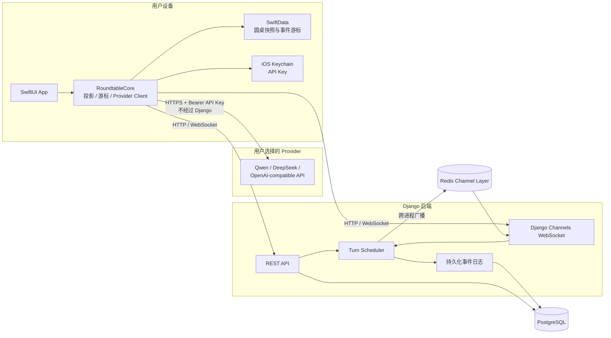

# Agent Roundtable 架构

**版本：** MVP v0.1.0

## 信任边界

- API Key 只在 SwiftUI/`RoundtableCore` 的 Provider 调用路径和 iOS Keychain 中出现。
- Django 只接收 Provider 类型、BaseURL、Model 等非秘密元数据；发现任何 `api_key` 形态字段会直接拒绝请求。
- 真实模型请求由 iOS 直连 Provider。用户内容进入 Provider 前会经过本地内容策略和首次第三方数据提示。
- Django 是圆桌状态、turn 签发、消息顺序、事件日志和结论版本的服务端权威。
- PostgreSQL 保存圆桌、消息、turn、事件、用量、结论和举报；Redis 只承担 Channels 跨进程广播，不替代持久化事件补发。

## 一次真实 Turn 的顺序

1. iOS 调用 `POST /turns/next`，Django 在事务中签发唯一 pending turn 并持久化 `agent.thinking`。
2. iOS 直连 Provider，流式内容只在当前设备临时展示。
3. iOS 将结构化消息提交到 `POST /messages`，或通过 `/turns/pass`、`/turns/fail` 关闭 turn。
4. Django 校验 turn、Agent、引用和预算，写入 PostgreSQL，并通过 Redis 广播事件。
5. iOS 按 `event_id` 去重、按 `sequence` 推进游标，同时写入 SwiftData。
6. 断线后 iOS 携带最后游标重连；服务端从事件日志补发，游标过期时发送完整 `room.joined` 快照。

## 部署拓扑

`docker-compose.yml` 启动四个服务：

- `db`：PostgreSQL 16。
- `redis`：Redis 7，启用 AOF。
- `backend`：Daphne + Django ASGI，启动前自动执行迁移。
- `purge`：可选 `ops` profile，执行 90 天保留清理。

本地单元测试默认不要求 Redis；设置 `REDIS_URL` 后才启用 `channels_redis`。Compose 始终设置 Redis，避免多进程广播失效。
