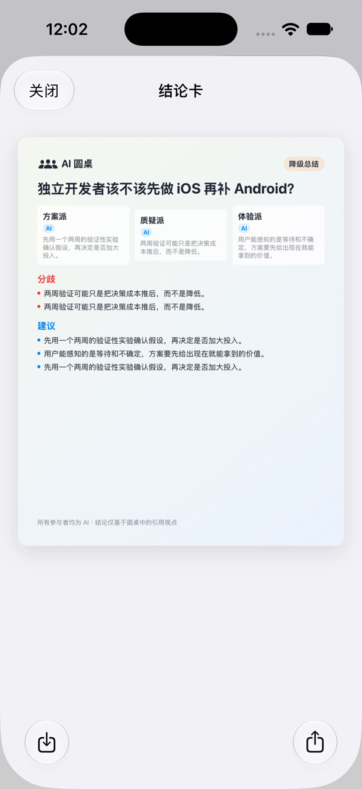

# Agent Roundtable 演示

完整录屏：[`demo-v0.1.0.mp4`](assets/demo-v0.1.0.mp4)

[](assets/demo-v0.1.0.mp4)

本次录屏使用 iPhone 17 / iOS 27.0 模拟器和真实本地 Compose 后端，实际覆盖：

- 创建圆桌并确认三个固定 AI 参与者。
- 第一轮 Mock 讨论、结构化观点和引用。
- 用户输入、点名体验派、暂停边界与继续讨论。
- 第二轮引用式互评。
- 无 Provider 时的规则化降级结论、结论卡预览、保存与分享入口。

录屏为 H.264 MP4，1206 × 2622，时长 4 分 43 秒。录制过程不包含真实 API Key、公司资料或第三方版权素材。

## 三个演示议题

### 1. 旅行决策

> 五天四晚的京都和大阪行程，应该把更多时间放在历史文化体验，还是城市美食探索？

预期看点：方案派给出可执行行程，质疑派指出移动和预约风险，体验派比较体力消耗与真实体验。

### 2. 产品方案比较

> 两人开发团队做新移动产品，应该先完成 iOS 全主流程，还是同时铺开 iOS 与 Android？

预期看点：方案派拆解验证路径，质疑派检查资源与维护成本，体验派关注用户反馈速度。

### 3. 正反观点讨论

> AI 生成代码进入生产环境前，是否必须保留人工逐行审查？

预期看点：结构化引用、支持与质疑关系、共识和未解决分歧。

## 录制流程

1. 新建圆桌并输入议题。
2. 确认三个固定 AI 参与者。
3. 播放第一轮 Mock 讨论，展示不同立场和观点。
4. 输入用户消息并点名体验派，展示暂停边界。
5. 继续讨论，播放第二轮，展示引用和挑战关系。
6. 打开结论卡，展示共识、分歧、建议、未决问题与分享入口。

录制使用真实本地 Django/Channels 后端和 iOS UI 自动化，不包含真实 API Key、公司资料或第三方素材。

## 复现

需要 macOS、Xcode、XcodeGen、Docker 和一个可用的 iPhone 模拟器。

```bash
make docker-up
make record-demo
make docker-down
```

默认输出：

```text
docs/assets/demo-v0.1.0.mp4
```

脚本调用 `ReleaseDemoUITests/testReleaseDemoFlow`，同时录制同一模拟器画面。后端不在 `localhost:8000` 时，请先调整 `RT_API_BASE_URL` 对应的启动配置或端口映射。

可播放性和编码检查：

```bash
ffprobe -v error \
  -show_entries format=duration,size \
  -show_entries stream=codec_name,width,height \
  -of default=noprint_wrappers=1 \
  docs/assets/demo-v0.1.0.mp4
```
